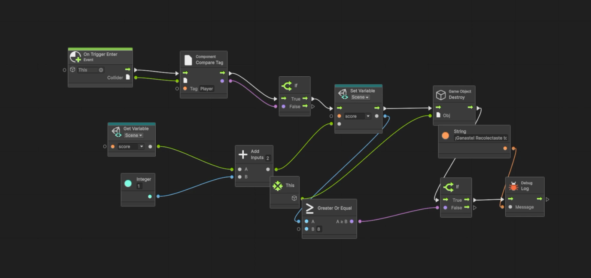

# ScriptVsVisual

Prototipo en Unity 6 de recolección de piezas doradas dentro de una arena, que integra dos enfoques de programación:

- **Movimiento (C#):** `PlayerMovement.cs` controla el desplazamiento del jugador con las flechas del teclado.
- **Recolección (Visual Scripting):** el grafo `CollectItem` suma un punto y destruye la pieza al detectar la colisión. Al alcanzar 8 puntos se muestra el mensaje de victoria.

## Grafo de Visual Scripting

## Comparación

- **Facilidad de implementación:** C# resulta más directo para el movimiento; Visual Scripting agiliza eventos como las colisiones.
- **Legibilidad:** el grafo se interpreta de forma visual e inmediata, aunque se complica al crecer; el código es más compacto.
- **Escalabilidad:** C# facilita el mantenimiento y la reutilización; Visual Scripting se adecúa a prototipos y lógica puntual.

## Desafíos

- Se presentó un error de Unity 6 con el sistema de entrada, resuelto al configurar *Active Input Handling* en *Both*.
- Se requirió precisión al conectar los puertos de los nodos del grafo.
